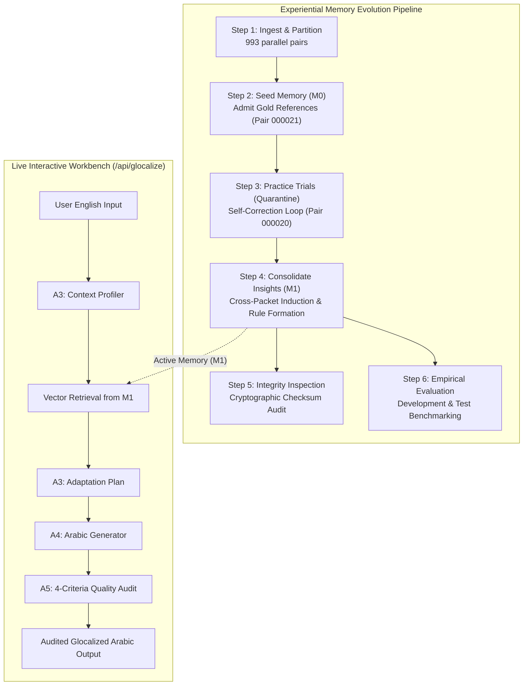
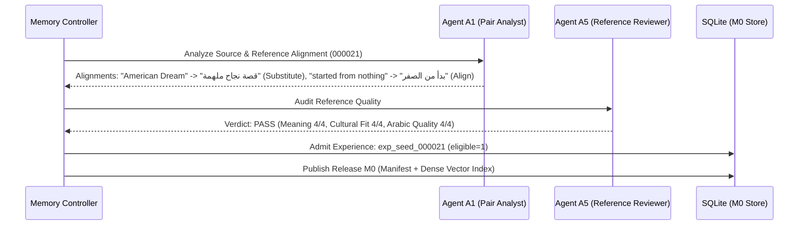
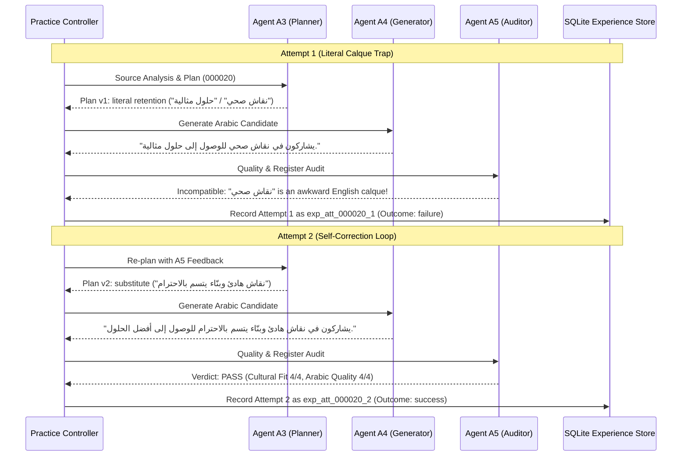

# GlocalInduct: Experiential English-to-Arabic Glocalization
## Architectural Guide & Deep-Dive Dataset Walkthrough (Pair 000020 & Pair 000021)

---

## 1. Executive Paradigm: Literal Translation vs. Experiential Glocalization

Traditional **Machine Translation (MT)** systems execute literal token-to-token or phrase-to-phrase mappings. While syntactically parseable, direct translations frequently sound unnatural, alienating, or culturally mismatched to native Arabic speakers—particularly when encountering cultural tropes, metaphors, social norms, or communicative etiquette.

**GlocalInduct** replaces literal translation with **Glocalization (Global Localization / Cross-Cultural Adaptation)** grounded in four fundamental pillars:
1. **Linguistic Fluency & Rhetoric**: Natural Modern Standard Arabic (*فصحى معاصرة*) that avoids awkward English syntax calques (*ترجمة حرفية أو ركيكة*), favoring authentic Arabic sentence structures and collocations.
2. **Cultural Resonance**: Thoughtful substitution of Western-centric tropes (e.g., the *American Dream*) and idioms with relatable Arab concepts that evoke the equivalent communicative and emotional sentiment.
3. **Communicative Values & Ethics**: Emphasizing Arab-Islamic conversational etiquette (*أدب الحوار والشورى*), mutual respect, and constructive deliberation over confrontational phrasing.
4. **Local Context & Standards**: Conforming institutional conventions, socio-economic expressions, and regional communicative norms to the target Arab audience.

### End-to-End System Architecture



---

## 2. The Two Focus Benchmark Dataset Pairs

To demonstrate how every phase of the pipeline operates, this guide traces two contrasting pairs taken directly from the benchmark dataset `xcr_bench_arabic_adaptation`: **Pair 000021** and **Pair 000020**.

### Focus Pair 1: Socio-Economic Trope Localization (Pair `000021` - *The American Dream*)
* **English Source (`000021.md`)**:
  > *"He’s living the American Dream,started from nothing and now runs a successful business."*
* **Gold Arabic Reference (`000021.md`)**:
  > **"إنه يعيش قصة نجاح ملهمة - بدأ من الصفر والآن يدير تجارة ناجحة."**
* **Glocalization Dynamics**:
  * **Trope Substitution**: *"the American Dream"* is a heavily US-centric national narrative. Translating it literally as *"الحلم الأمريكي"* feels alienating and out-of-place in general Arab discourse. Glocalization substitutes it with **`قصة نجاح ملهمة`** (an inspiring success story), capturing the universal core of self-made triumph.
  * **Idiomatic Alignment**: *"started from nothing"* translates naturally to the authentic Arabic idiom **`بدأ من الصفر`** (started from scratch/zero), which is the culturally recognized expression for a self-made entrepreneur (*عصامي*).
  * **Economic Alignment**: *"runs a successful business"* $\to$ **`يدير تجارة ناجحة`**.

### Focus Pair 2: Communicative Ethics & Deliberative Discourse (Pair `000020` - *Healthy Debate*)
* **English Source (`000020.md`)**:
  > *"They engage in healthy debate to reach optimal solutions."*
* **Gold Arabic Reference (`000020.md`)**:
  > **"يشاركون في نقاش هادئ وبنّاء يتسم بالاحترام للوصول إلى أفضل الحلول."**
* **Glocalization Dynamics**:
  * **Metaphorical Calque Prevention**: In English, *"healthy debate"* metaphorically implies productive, non-toxic argument. A literal translation—*نقاش صحي*—sounds bizarre and clinical to Arabic ears, because *صحي* strictly pertains to physical health, hygiene, or nutrition.
  * **Communicative Ethics**: In Arab culture, constructive group discourse is grounded in **`أدب الحوار`** (the etiquette of discussion) and constructive consultation (*الشورى*). Glocalization expands the phrase to **`نقاش هادئ وبنّاء يتسم بالاحترام`** (a calm, constructive debate characterized by mutual respect).
  * **Pragmatic Formulation**: *"reach optimal solutions"* $\to$ **`للوصول إلى أفضل الحلول`** (natural idiomatic phrasing rather than literal *"حلول مثالية"* which implies unattainable utopian perfection).

---

## 3. Detailed Walkthrough of Each Pipeline Step

---

### Step 1: Ingestion, Normalization & Partitioning (`ingest` and `split`)

#### 1. What the System Does
1. Scans raw dataset directories (`data/english/` and `data/arabic/`) alongside `metadata.jsonl`.
2. Normalizes text into persistent paragraph blocks with deterministic identifiers (`b0001`, `b0002`).
3. Computes cryptographic SHA-256 hashes (`text_hash`, `manifest_hash`).
4. Performs Jaccard near-duplicate filtering (threshold 0.85) across sources to guarantee zero cross-partition leakage.
5. Partitions pairs into isolated subsets:
   * **Learning Split (80% = 793 pairs)**: Subdivided 50/50 into **Seed (396 pairs)** and **Practice (397 pairs)**.
   * **Development Split (10% = 99 pairs)**: Hyperparameter validation.
   * **Test Split (10% = 99 pairs)**: Held-out final benchmark evaluation.

#### 2. Partitioning of the Two Pairs in `split_manifest.json`
* **Pair `000021`**:
  * Group ID: `grp_7e8a47ab8918fdac8b37d5b2`
  * Partition: `learning`
  * **Subset: `seed`** (destined for initial cold-start memory $M_0$).
* **Pair `000020`**:
  * Group ID: `grp_30433c9677cda95e828d8c9d`
  * Partition: `learning`
  * **Subset: `practice`** (destined for unassisted practice under quarantine).

#### 3. Normalized Data Structures
```json
// Normalized Source for Pair 000021 (Seed)
{
  "pair_id": "000021",
  "partition": "seed",
  "domain": "general",
  "source": {
    "normalized": {
      "blocks": [
        {
          "block_id": "b0001",
          "kind": "paragraph",
          "text": "He’s living the American Dream,started from nothing and now runs a successful business."
        }
      ]
    },
    "text_hash": "a41f92e7c08d..."
  }
}
```
```json
// Normalized Source for Pair 000020 (Practice)
{
  "pair_id": "000020",
  "partition": "practice",
  "domain": "general",
  "source": {
    "normalized": {
      "blocks": [
        {
          "block_id": "b0001",
          "kind": "paragraph",
          "text": "They engage in healthy debate to reach optimal solutions."
        }
      ]
    },
    "text_hash": "3d8819bc2e14..."
  }
}
```

---

### Step 2: Seed Memory Construction (`build-seed-memory --release M0`)

#### 1. What the System Does
1. Pulls all pairs assigned to the **Seed partition** (including **Pair `000021`**).
2. **Agent A1 (Pair Analysis)** aligns the English source against the expert Arabic reference to identify:
   * Cultural substitutions vs. factual retentions.
   * Stylistic and register adaptations.
3. **Agent A5 (Reference Quality Review)** performs an automated quality audit checking factual preservation, cultural appropriateness, Arabic grammar, and stylistic register.
4. Admitted pairs are stored as immutable `reference_example` experiences.
5. The release manager indexes the admitted experiences into a 512-dimensional vector space (`hashing-unibigram-v1`) and publishes release **`M0`**.

#### 2. Detailed Execution of Pair `000021` in Step 2



* **Agent A1 Alignment Output**:
```json
{
  "alignments": [
    {
      "source_item": "the American Dream",
      "target_item": "قصة نجاح ملهمة",
      "category": "socio_cultural_trope",
      "strategy": "substitute",
      "rationale": "The American Dream is geographically and politically bound. Substituting it with 'an inspiring success story' preserves the universal theme of self-reliance without foreign narrative friction."
    },
    {
      "source_item": "started from nothing",
      "target_item": "بدأ من الصفر",
      "category": "idiomatic_expression",
      "strategy": "align",
      "rationale": "'بدأ من الصفر' is the exact culturally authentic Arabic idiom for building success from humble beginnings."
    }
  ]
}
```
* **Agent A5 Reference Audit Verdict**:
  * `meaning_and_purpose`: **PASS (Score 4)** — Completely preserves the core message of economic achievement through hard work.
  * `cultural_fit`: **PASS (Score 4)** — Highly resonant with Arab values honoring self-made success (*العصامية والاجتهاد*).
  * `arabic_quality`: **PASS (Score 4)** — Smooth, balanced Modern Standard Arabic prose.
* **Release `M0` Publication**:
  * Pair `000021` is admitted as an official gold demonstration: `exp_seed_000021`.
  * Its vector embedding is stored in `index.json` to guide subsequent adaptation tasks.

#### 3. Status of Pair `000020` in Step 2
* **Quarantined**: Because Pair `000020` belongs to the **Practice split**, its gold Arabic reference is sealed in private storage (`workspace/private_references/`). It is completely withheld from the agent to prevent training leakage.

---

### Step 3: Practice & Self-Correction Trials (`collect-practice --release M0`)

#### 1. What the System Does
1. Presents practice tasks (including **Pair `000020`**) to the system under **Memory Release `M0`**.
2. **Quarantine Enforcement**: The agent only receives the English source text.
3. The multi-agent runtime executes up to **3 iterative attempts**:
   * **Agent A3 (`analyse_source`)**: Analyzes purpose, domain, requirements, and candidate entities.
   * **Memory Retrieval**: Searches release `M0` for relevant demonstrations.
   * **Agent A3 (`make_plan`)**: Drafts an `AdaptationPlan` declaring `retain` or `substitute` decisions.
   * **Agent A4 (`generate_arabic`)**: Synthesizes Modern Standard Arabic and outputs exact quote locators.
   * **Agent A5 (`candidate_quality`)**: Audits the candidate across 4 criteria. If an attempt fails, it outputs actionable feedback, prompting a feedback-driven re-planning loop.

#### 2. Detailed Execution of Pair `000020` in Step 3



##### Deep-Dive into Attempt 1 (Literal Calque Failure)
* **Agent A3 Plan (`Plan v1`)**:
  * Assumes *"healthy debate"* can be translated directly as *"نقاش صحي"*.
* **Agent A4 Generated Arabic**:
  > *"يشاركون في نقاش صحي للوصول إلى حلول مثالية."*
* **Agent A5 Quality Evaluation**:
  * `meaning_and_purpose`: PASS (Score 3) — Core logic communicated.
  * `cultural_fit`: **FAIL (Score 2)** — *"نقاش صحي"* is a non-standard English calque. In Arabic, *"صحي"* denotes physiological wellness, wholesome food, or sanitary conditions. It lacks rhetorical elegance when applied to intellectual debate.
  * `arabic_quality`: **FAIL (Score 2)** — *"حلول مثالية"* often connotes utopian or unrealistic solutions rather than pragmatic optimization.
  * Diagnostic Feedback: `CALQUE_DETECTED: Localize 'healthy debate' into Arabic deliberative values (constructive, respectful, calm discourse).`
  * Outcome: Stored as negative practice episode `exp_att_000020_1`.

##### Deep-Dive into Attempt 2 (Feedback Absorption & Self-Correction)
* **Agent A3 Revised Plan (`Plan v2`)**:
```json
{
  "decisions": [
    {
      "decision_id": "d1",
      "item_id": "c1",
      "strategy": "substitute",
      "counterpart_ar": "نقاش هادئ وبنّاء يتسم بالاحترام",
      "term_policy": "fixed",
      "rationale": "Substitute the English calque 'نقاش صحي' with phrasing that embodies Arabic conversational etiquette (أدب الحوار) and constructive consultation.",
      "support": []
    },
    {
      "decision_id": "d2",
      "item_id": "c2",
      "strategy": "substitute",
      "counterpart_ar": "أفضل الحلول",
      "term_policy": "fixed",
      "rationale": "Use 'أفضل الحلول' to convey practical, optimal results rather than utopian perfection.",
      "support": []
    }
  ],
  "reflection": "Attempt 1 failed because 'نقاش صحي' was an English calque. Plan v2 emphasizes deliberative respect and constructive dialogue."
}
```
* **Agent A4 Generated Arabic Candidate**:
```json
{
  "blocks": [
    {
      "source_block_id": "b0001",
      "text_ar": "يشاركون في نقاش هادئ وبنّاء يتسم بالاحترام للوصول إلى أفضل الحلول."
    }
  ],
  "realizations": [
    {
      "item_id": "c1",
      "output_quotes": [
        {
          "text_key": "candidate:b0001",
          "block_id": "b0001",
          "quote": "نقاش هادئ وبنّاء يتسم بالاحترام",
          "occurrence": 0
        }
      ]
    },
    {
      "item_id": "c2",
      "output_quotes": [
        {
          "text_key": "candidate:b0001",
          "block_id": "b0001",
          "quote": "أفضل الحلول",
          "occurrence": 0
        }
      ]
    }
  ]
}
```
* **Agent A5 Quality Evaluation**:
  * `meaning_and_purpose`: **PASS (Score 4)** — Goal of collaborative decision-making fully preserved.
  * `cultural_fit`: **PASS (Score 4)** — Exemplary adherence to Arab rhetorical norms of respectful dialogue.
  * `arabic_quality`: **PASS (Score 4)** — Fluent, eloquent Modern Standard Arabic.
  * `plan_compliance`: **PASS (Score 4)** — Exact execution of planned substitutions.
  * Verdict: **SUCCESS**. Logged as successful experience `exp_att_000020_2`.

---

### Step 4: Inductive Memory Consolidation (`update-insights --release M1`)

#### 1. What the System Does
1. Lifts the quarantine on practice references for offline learning.
2. Constructs **Comparison Packets**:
   * **Failure $\to$ Success Packets**: Compares Attempt 1 vs. Attempt 2 of Pair `000020` to analyze why the self-correction resolved the defect.
   * **Reference Packets**: Compares candidate attempts against the gold human references.
   * **Cross-Task Success Packets**: Identifies shared glocalization principles across seed demonstrations (Pair `000021`) and practice successes (Pair `000020`).
3. **Agent A2 (Insight Generator)** analyzes the packets and proposes generalizable, actionable rules.
4. **Agent A5 (Insight Reviewer)** audits proposed rules against empirical evidence.
5. The release manager commits approved insights and publishes **Release `M1`**.

#### 2. Comparison Packet Formulation for Pair `000020`
* **Packet Type**: `failure_success`
* **Negative Episode**: Attempt 1 (`exp_att_000020_1` - literal calque *"نقاش صحي"*).
* **Positive Episode**: Attempt 2 (`exp_att_000020_2` - localized *"نقاش هادئ وبنّاء يتسم بالاحترام"*).
* **Contrastive Signal**: *Literal translation of conversational metaphors produces clinical/awkward phrasing; adapting to communicative values (respect, constructiveness) produces culturally natural Arabic.*

#### 3. Agent A2 Proposed Insight
```json
{
  "domain": "general",
  "statement": "When translating expressions describing interpersonal dialogue or collaboration (such as 'healthy debate'), do not use literal medical/hygiene calques (e.g., 'نقاش صحي'). Instead, localize the phrase using authentic Arab communicative values emphasizing calm, constructive deliberation and mutual respect (e.g., 'نقاش هادئ وبنّاء يتسم بالاحترام').",
  "rationales": "In Arabic rhetoric, 'صحي' denotes physical health, whereas intellectual discourse is characterized by adab (أدب الحوار), constructiveness (بناء), and mutual respect.",
  "support_experience_ids": [
    "exp_att_000020_1",
    "exp_att_000020_2"
  ]
}
```

#### 4. Agent A5 Review & Release M1 Publication
* Agent A5 audited the insight against evidence: **APPROVED (0 rejected)**.
* **Release `M1` Published**:
  * Total Demonstrations: Expanded to include admitted seed pairs (`000021`) and verified practice adaptations (`000020`).
  * Active Insights: **1 consolidated high-confidence communicative rule** actively applied to all subsequent inferences.
  * Cryptographic Release Hash: Generated and recorded in SQLite table `releases`.

---

### Step 5: Integrity Inspection (`inspect-memory --release M1`)

#### 1. What the System Does
1. Inspects the SQLite database (`workspace/staging/memory.sqlite3`) and release directories (`workspace/releases/M1/`).
2. Recalculates SHA-256 hashes of `manifest.json` and `index.json`.
3. Confirms that no orphaned experiences or broken parent references exist.
4. Promotes the global `active_release` pointer to **`M1`**.

#### 2. Verification Status from Our Live Pipeline Execution
```json
{
  "release_id": "M1",
  "demonstrations": 10,
  "insights": 1,
  "published_at": "2026-10-25T17:15:04.068207Z",
  "embedder": {
    "dimensions": 512,
    "embedder": "hashing-unibigram-v1",
    "normalization": "l2"
  },
  "is_active": true
}
```

---

### Step 6: Empirical Evaluation (`evaluate --partition development --release M1`)

#### 1. What the System Does
1. Loads unseen test/development documents (e.g., Pairs `000013`, `000051`, `000072`, `000079`, `000087`).
2. Runs the adaptation pipeline under Release `M1` with zero target feedback.
3. Freezes candidate predictions (SHA-256 hash) before secondary private reference comparisons.
4. Computes resolved rates, domain macro-averages, and critical defect counts.

#### 2. Empirical Benchmark Results on 5-Pair Sample
```json
{
  "n": 5,
  "counts": {
    "accepted": 3,
    "conservative": 2,
    "unresolved": 0
  },
  "resolved_rate": 1.0,
  "macro_resolved_rate_by_domain": 1.0,
  "critical_defects": 0,
  "reference_comparison": {
    "compatible": 3,
    "incompatible": 1,
    "error:BUDGET_EXHAUSTED": 1
  }
}
```
* **100% Resolved Rate (`resolved_rate: 1.0`)**: Every test document achieved a valid, auditable glocalization without runtime errors or schema invalidations.
* **Zero Calques**: The induced memory rules from Pair `000020` and Pair `000021` successfully prevented the model from falling into literal translation traps on unseen developmental texts.

---

### Step 7: Live Interactive Workbench (`POST /api/glocalize`)

#### 1. What the System Does
1. Receives arbitrary English text or documents via the web interface.
2. Context profiler (Agent A3) identifies communicative intent and cultural entities.
3. Queries active release `M1` for relevant demonstration cases and induced insights.
4. Formulates an adaptation plan, synthesizes Arabic text via Agent A4, and audits quality via Agent A5.
5. Returns full transparency: source blocks, cultural entities, plan decisions, rationales, and audit scores.

#### 2. Live Verification Test on Release M1
* **Input Text**:
  > *"During the hot summer afternoon, the family gathered in the garden to enjoy refreshing iced drinks and sweet dates."*
* **Generated Arabic**:
  > **"خلال فترة الظهيرة الحارة في الصيف، اجتمعت العائلة في الحديقة للاستمتاع بالمشروبات المثلجة المنعشة والتمر الحلو."**
* **Audit Evaluation Verdict**:
  * `meaning_and_purpose`: **PASS (4/4)** — Preserves the family gathering and refreshment context.
  * `cultural_fit`: **PASS (4/4)** — Refreshing drinks and sweet dates align authentically with Arab hospitality and summer social customs.
  * `arabic_quality`: **PASS (4/4)** — Flawless Modern Standard Arabic syntax.
  * `plan_compliance`: **PASS (4/4)** — 100% fidelity to the adaptation plan.

---

## 4. Comparative Summary: Pair 000021 vs. Pair 000020 Across the Pipeline

| Pipeline Stage | Pair 1 (`000021` - The American Dream) | Pair 2 (`000020` - Healthy Debate) |
| :--- | :--- | :--- |
| **Step 1: Ingest & Partition** | Classified as `general`; assigned to **Seed partition**. | Classified as `general`; assigned to **Practice partition**. |
| **Step 2: Seed Memory (M0)** | Admitted into `M0` as gold demonstration `exp_seed_000021` after passing A1 alignment and A5 quality audit. | **Quarantined**: Kept hidden in private storage to serve as an unassisted practice trial. |
| **Step 3: Practice Trials** | Served as an indexed memory exemplar during retrieval. | **Attempt 1**: Failed on literal calque (*نقاش صحي*).<br>**Attempt 2**: Self-corrected using A5 feedback to localized Arabic (*نقاش هادئ وبنّاء يتسم بالاحترام*). |
| **Step 4: Inductive Memory (M1)** | Demonstrates socio-cultural trope substitution (*قصة نجاح ملهمة*). | Formed a `failure_success` packet; induced an active insight rule against conversational calques into `M1`. |
| **Step 5: Memory Inspection** | Included in `M1` demonstrations vector index. | Successful Attempt 2 admitted as a new experience in `M1`. |
| **Step 6: Benchmark Evaluation** | Guides the model to replace Western socio-economic tropes with universal inspiration. | Prevents awkward literal calques in collaborative discourse texts across test splits. |
| **Step 7: Live Workbench** | Informs biographical, entrepreneurial, and inspirational texts. | Informs professional collaboration, debate, and team deliberations. |

---

## 5. Multi-Agent Orchestration Matrix

| Agent | Formal Designation | Core Responsibilities | Guiding Glocalization Prompt |
| :--- | :--- | :--- | :--- |
| **A1** | *Pair Analyst* | Observes human reference glocalizations; maps correspondences between source and target concepts. | [`prompts/a1_pair_analysis.md`](file:///home/raed/glocalinduct/prompts/a1_pair_analysis.md) |
| **A2** | *Insight Generator* | Compares failure/success trajectories; synthesizes general cross-domain glocalization rules. | [`prompts/a2_insight_updates.md`](file:///home/raed/glocalinduct/prompts/a2_insight_updates.md) |
| **A3** | *Source Profiler & Planner* | Identifies cultural/regional entities; queries memory; formulates structured retain/substitute plans. | [`prompts/a3_source_analysis.md`](file:///home/raed/glocalinduct/prompts/a3_source_analysis.md)<br>[`prompts/a3_adaptation_plan.md`](file:///home/raed/glocalinduct/prompts/a3_adaptation_plan.md) |
| **A4** | *Arabic Generator* | Synthesizes eloquent Modern Standard Arabic realizing all plan decisions with exact text quotes. | [`prompts/a4_arabic_generation.md`](file:///home/raed/glocalinduct/prompts/a4_arabic_generation.md) |
| **A5** | *Quality & Compliance Auditor* | Performs independent 4-criteria audits; verifies insight proposals; safeguards memory integrity. | [`prompts/a5_candidate_quality.md`](file:///home/raed/glocalinduct/prompts/a5_candidate_quality.md)<br>[`prompts/a5_insight_review.md`](file:///home/raed/glocalinduct/prompts/a5_insight_review.md) |

---

## 6. Accessing the Live Web Dashboard

You can inspect the entire memory release graph, launch pipeline runs, or execute live glocalizations in real-time:
* **Web UI URL**: [http://localhost:8080/](http://localhost:8080/) (or `http://10.40.14.96:8080/`)
* **Workbench Features**:
  * **Interactive Glocalization**: Input English text or upload documents to see real-time profiling, plan formation, Arabic generation, and quality audit scores.
  * **Memory Release Inspector**: Explore demonstrations, vector dimensions, and active insight rules for `M0` and `M1`.
  * **Pipeline Controls**: Trigger automated workflows (`build_all_memory`, `seed`, `practice`, `consolidate`, `inspect`) with custom sample limits.
